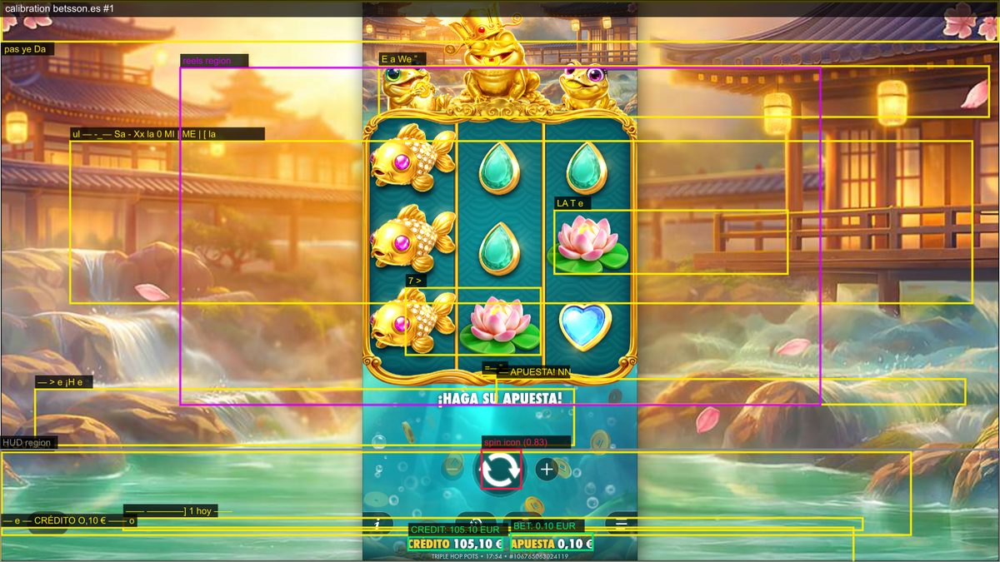
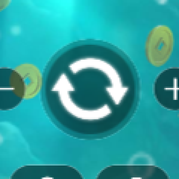
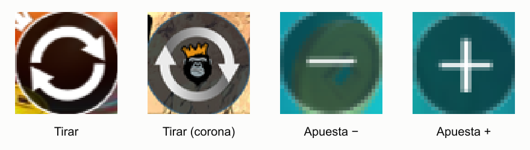

# Informe 1 — Escenario 1: tirada completada en Real Play

**Resultado: ✅ todas las comprobaciones superadas** · betsson.es · Pragmatic Play *Triple Hop Pots* · Real Play · apuesta mínima · ejecución real del 15/10/2026 (15:09–15:10, 1,3 min), desde un Brave con perfil vacío.

Comando: `npm run all` (parte 1) o, suelto, `npx playwright test --project=betsson.es tests/scenarios/scenario1-real-play-spin.spec.ts`.

## Qué pide el reto y qué se comprobó en pantalla

| Requisito del reto | Paso atómico | Lo que se vio en pantalla | Resultado |
|---|---|---|---|
| Abrir el lobby y autenticarse | `site.loggedIn` | saldo visible en la cabecera de Betsson | ✅ |
| Lanzar un juego de Pragmatic Play | `site.goToGame` | ficha `game-detail-pragmaticPlayTripleHopPots` | ✅ |
| Entrar en Real Play | `site.gameSession` | aviso de juego responsable aceptado · límites: tiempo «5 Horas», pérdidas «25 % (26,57 €)» | ✅ |
| El juego se ve | `game.attach` | canvas del proveedor renderizado (no en blanco) | ✅ 4,8 s |
| El juego está listo | `game.enter` | intro superada · CRÉDITO y APUESTA legibles | ✅ 14,2 s |
| Leer el saldo de Betsson antes | `betsson.readBalance` | **106,26 €** | ✅ |
| Identificar apuesta y moneda | `game.readHud` | CRÉDITO **106,26 €** · APUESTA **0,10 €** · EUR · etiquetas en español · dos lecturas iguales | ✅ |
| Solo tirar si es seguro | `money.preflight` | crédito ≥ apuesta, Betsson ≥ apuesta, EUR | ✅ |
| Localizar el control y tirar | `game.spin` | botón encontrado **por imagen** (plantilla con corona, coincidencia 0,86, localizado por Hough) · **los rodillos se mueven** | ✅ |
| La tirada empezó **y terminó** | `game.spinEnd` | botón disponible + rodillos quietos + CRÉDITO estable 5 lecturas | ✅ 6,1 s |
| La apuesta mostrada es la usada | `money.wagerUsed` | apuesta antes 0,10 € = después 0,10 € · cobrado **0,10 €** | ✅ |
| Saldo del juego coherente | `money.game` | **106,26 − 0,10 + 0,00 = 106,16 €** · leído 106,16 € | ✅ |
| Saldo de Betsson cuadra | `money.betsson` | **106,26 − 0,10 + 0,00 = 106,16 €** · leído 106,16 € (1 lectura) | ✅ |
| Extra: saldo de la página = último CRÉDITO | `site.exitBalance` | al salir del juego: página **106,16 €** = juego 106,16 € | ✅ |

> Regla del reto: `saldo después = saldo antes − apuesta + premio`. Esta tirada no tuvo premio (0,00 €), así que el saldo bajó exactamente la apuesta. Lo comprobamos **dos veces**: en el juego (OCR) y en Betsson (DOM de la web).

## Lo que ve el checker

Captura real anotada por el checker (calibración, sin tirada): zona del HUD, **CRÉDITO 105,10 € y APUESTA 0,10 € leídos por OCR** (etiquetas verdes), **botón de tirar localizado por imagen** (recuadro rojo, coincidencia 0,83) y zona de rodillos (morado) donde se mide el movimiento.



El botón de tirar visto de cerca, y las plantillas con las que el checker reconoce los controles:





## Log real de la ejecución (extracto)

```
15:09:37 ✓ [site.loggedIn] balance visible in the header
15:09:45 ✓ [site.goToGame] game "triple-hop-pots" · detail id game-detail-pragmaticPlayTripleHopPots (7.8s)
15:09:47 ✓ [site.gameSession] responsible-gambling notice acknowledged → limits: play time "5 Horas", loss limit "25% (26,57 €)"
15:09:52 ✓ [game.attach] canvas rendered (4.8s)
15:10:06 ✓ [game.enter] playable in 14.2s · CREDIT 106.26 EUR · BET 0.10 EUR
15:10:15 ✓ [betsson.readBalance] 106.26 EUR
15:10:19 ✓ [game.readHud] CREDIT 106.26 EUR · BET 0.10 EUR
15:10:19 ✓ [money.preflight] safe to spin
15:10:21 ✓ [game.idleNoise] idle change 2.4%
15:10:25 ✓ [game.spin] clicked round arrows button found by image (spin-crown.png), score 0.86 (located by Hough, confirmed by image); reels move
15:10:31 ✓ [game.spinEnd] settled in 6.1s · CREDIT 106.16 stable for 5 reads, spin button available
15:10:31 ✓ [money.wagerUsed] BET shown 0.10 → after 0.10 · debited 0.10
15:10:31 ✓ [money.game] 106.26 − 0.10 + 0.00 = 106.16 EUR · read 106.16 EUR
15:10:34 ✓ [money.betsson] 106.26 − 0.10 + 0.00 = 106.16 EUR · read 106.16 EUR (1 reads)
15:10:37 ✓ [site.exitBalance] in-game CREDIT 106.16 EUR · Betsson page 106.16 EUR
  ✓  Scenario 1 — completed Real Play spin (1.3m)
```

## Por qué es una prueba «como un jugador»

- El juego es un **canvas**: nunca se lee su DOM. Saldo, apuesta, premio y botones salen **de los píxeles** (OCR y visión).
- **El clic no es la prueba**: la tirada cuenta como empezada solo si los rodillos cambian por encima del ruido de las animaciones en reposo (medido antes: 2,4 %) o si cambia el crédito.
- **Nunca se tira con un valor mal leído**: `money.preflight` exige dos lecturas iguales, la moneda del mercado y saldo suficiente. Si algo no cuadra, no se tira.
