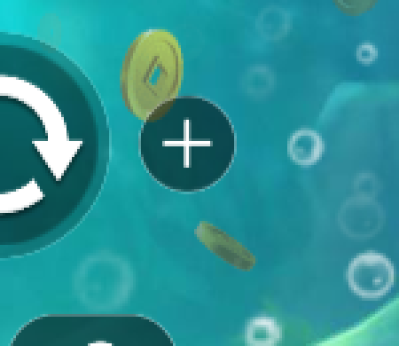

# Informe 4 — Subir la apuesta con «+» y tirar con ella

**Resultado: ✅ 57 comprobaciones superadas, 0 fallos** · ejecución real del 15/10/2026 (16:13–16:14, 1,6 min) · `npm run bet:raise` (también es la parte 4 de `npm run all`).

## Qué se comprobó en pantalla

| Paso | Paso atómico | Lo que se vio | Resultado |
|---|---|---|---|
| Apuesta al mínimo | `game.minBet` | 0,10 € (el «−» aparece atenuado: ya era el mínimo) | ✅ |
| Pulsar «+» una vez | `game.raiseBet` | «+» encontrado **por imagen junto al botón de tirar** (coincidencia 0,80) · APUESTA **0,10 → 0,20 €** leída tras la pulsación · tope de 0,50 € respetado · CRÉDITO sin cambios | ✅ |
| Saldo antes | `betsson.readBalance` · `game.readHud` | Betsson **104,60 €** · CRÉDITO 104,60 € · APUESTA **0,20 €** | ✅ |
| Tirada con la apuesta subida | `money.preflight` · `game.spin` · `game.spinEnd` | rodillos en movimiento · fin detectado en 6,9 s · CRÉDITO 104,40 € | ✅ |
| Se cobra **la apuesta subida** | `money.wagerUsed` | mostrada 0,20 € · cobrada **0,20 €** | ✅ |
| Los saldos cuadran | `money.game` · `money.betsson` | **104,60 − 0,20 + 0,00 = 104,40 €** en el juego **y** en Betsson | ✅ |
| Dejar la apuesta al mínimo | `game.minBet` | 0,20 → 0,10 € | ✅ |

```
16:13:41 · [game.raiseBet] "+" pressed (1/1) {"bet":0.2,"how":"bet plus button found by image (bet-plus.png) at (0.55, 0.83), score 0.80, scale 1.33"}
16:13:41 ✓ [game.raiseBet] BET 0.10 EUR → 0.20 EUR after 1 "+" press(es) · cap 0.50 EUR
16:13:54 ✓ [game.spin] clicked round arrows button found by image (spin-crown.png), score 0.85; reels move
16:14:01 ✓ [game.spinEnd] settled in 6.9s · CREDIT 104.40 stable for 5 reads, spin button available
16:14:01 ✓ [money.wagerUsed] BET shown 0.20 EUR → after 0.20 EUR · debited 0.20
16:14:01 ✓ [money.game] 104.60 − 0.20 + 0.00 = 104.40 EUR · read 104.40 EUR
16:14:06 ✓ [money.betsson] 104.60 − 0.20 + 0.00 = 104.40 EUR · read 104.40 EUR (1 reads)
16:14:15 ✓ [game.minBet] BET 0.20 EUR → 0.10 EUR
  ✓  Raise the wager with "+" (1 step(s), cap 0.50 €) and spin once (1.6m)
```

## El problema que encontramos en vivo y cómo se resolvió

En la primera prueba en vivo el «+» **no se encontró** y el paso se detuvo **sin tirar** (0 € gastados). La captura explica por qué: una **moneda del decorado tapa el borde del «+»**.



Medimos la plantilla en esa captura: en la zona correcta daba **0,835**, por encima del umbral de 0,70, así que la plantilla servía. Lo que fallaba era **la búsqueda**:

1. En toda la pantalla se prueban tamaños en saltos del 10 %, y un icono tan uniforme (disco oscuro con una cruz fina) pierde mucha puntuación si el tamaño no coincide casi exacto (aquí era 1,25×).
2. La búsqueda gruesa (rejilla de 3 px) solo afinaba **el mejor** candidato, y en este caso era un señuelo: el borde del botón de tirar.

La solución sirve para cualquier control:

- **Buscar el «+» junto al botón de tirar** (`NextToTarget`, a su derecha, como lo coloca Pragmatic), con tamaños finos (pasos del 3 %). El «−» se busca igual, a la izquierda.
- **Afinar los 5 mejores candidatos** de la búsqueda gruesa, no solo el primero. Esto mejora todas las búsquedas por imagen.
- El fotograma real con la moneda es ahora un **test de regresión** (`tests/unit/fixtures/pragmatic-plus-live.png`).

## Seguridad al cambiar la apuesta

- El «+» se pulsa **de uno en uno**, leyendo la APUESTA en pantalla tras cada pulsación, y **nunca pasa del tope** (`BET_MAX`, por defecto 0,50 €). Una pulsación que lo supere se deshace con «−» y no se tira.
- Mientras se cambia la apuesta, **el CRÉDITO no puede cambiar**. Si cambiara, significaría que una pulsación ha tocado otro control (por ejemplo, tirar), y el paso falla avisándolo.
