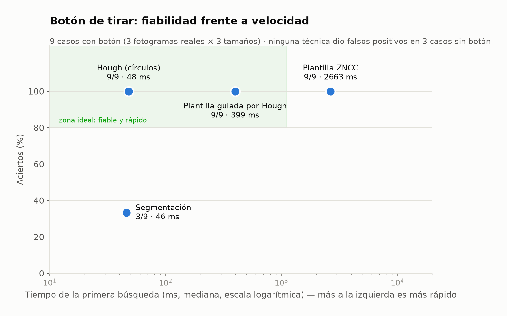
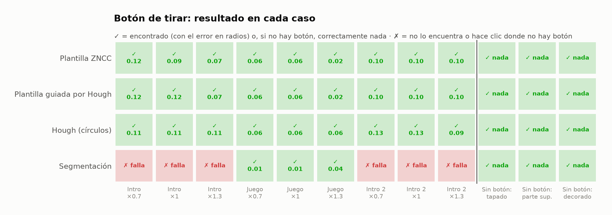
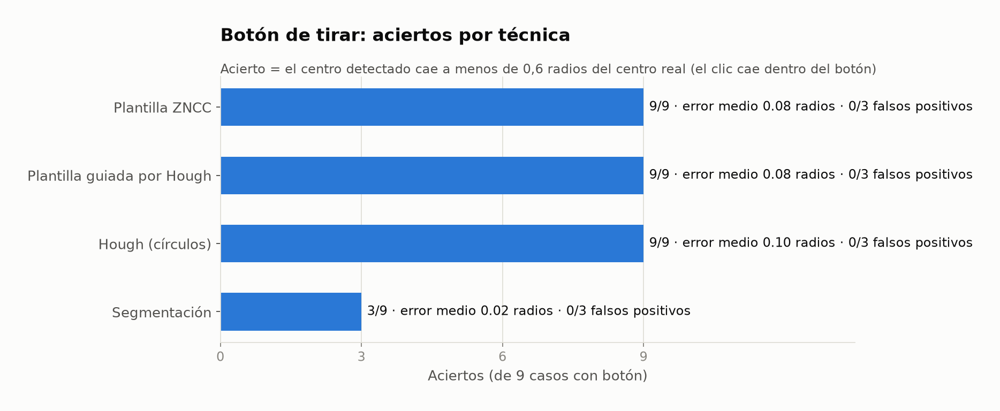
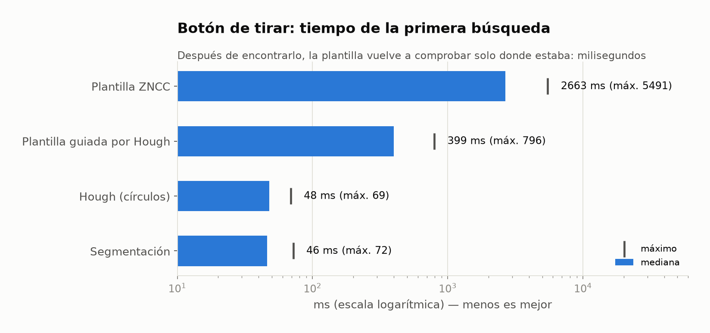
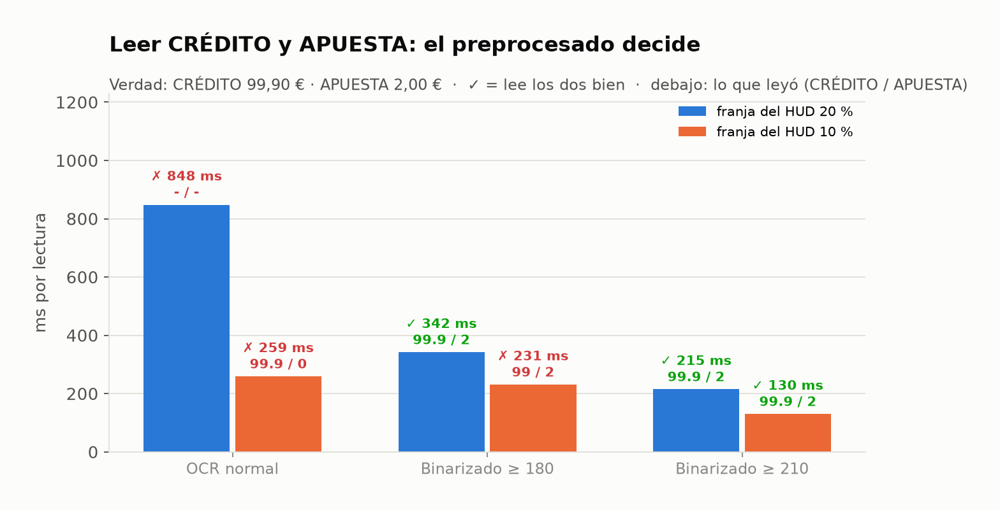
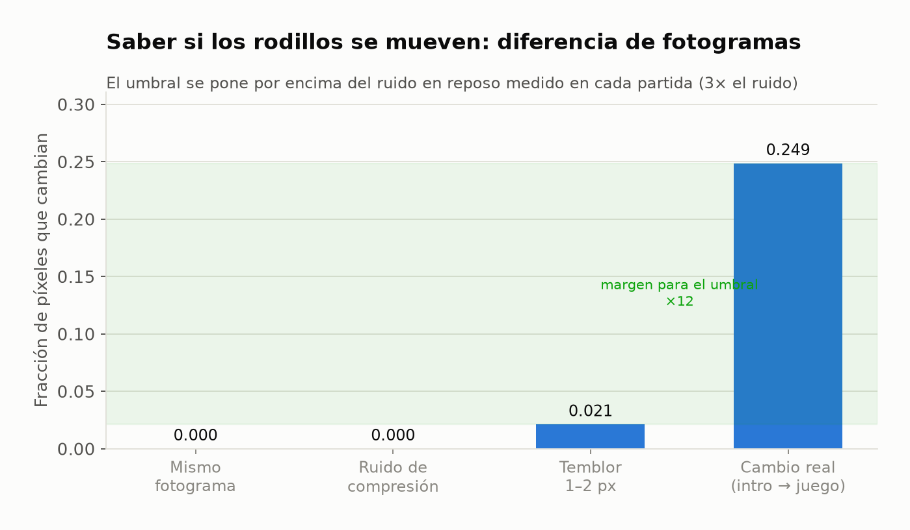

# Informe 6 — Visión y OCR: qué técnica usamos para cada cosa y por qué

El checker nunca lee el DOM del juego: todo sale **de los píxeles**. Cada técnica se eligió **midiéndola sobre fotogramas reales** del juego (`node scripts/bench-vision.cjs`, sin navegador y sin dinero). El detalle completo está en [`docs/vision-approaches.md`](../vision-approaches.md).

## Resumen

| Problema | Técnica | Dato medido |
|---|---|---|
| Encontrar el botón de tirar | **plantilla ZNCC guiada por Hough** → Hough → tecla ESPACIO → posición calibrada | **9/9 aciertos, 0 falsos positivos**, primera búsqueda ~0,4 s (plantilla sola: 2,7 s) |
| Encontrar «−» y «+» | plantilla **junto al botón de tirar** + afinado de los 5 mejores candidatos | «+» encontrado en vivo con una moneda tapando su borde |
| Leer CRÉDITO y APUESTA | OCR (Tesseract) con **binarización del texto brillante (≥ 210)** | la única variante correcta en las dos franjas del HUD; el OCR normal falla |
| Saber si los rodillos se mueven | **diferencia de fotogramas** con umbral sobre el ruido en reposo | ruido ≤ 0,021 frente a 0,249 en un cambio real: margen ×12 |
| Mensaje de saldo insuficiente | OCR + expresiones regulares por intención e idioma | «Fondos insuficientes…» leído en vivo, en español |

## Botón de tirar: fiabilidad frente a velocidad

## Resultado en cada caso

3 fotogramas reales × 3 tamaños, y 3 imágenes sin botón. El número es el error en radios del botón.

## Leer el saldo: el preprocesado decide

## Movimiento de los rodillos

## Conclusiones

1. **Cada problema tiene su técnica**, elegida por datos: plantilla y Hough para botones, OCR para números y diferencia de fotogramas para el movimiento.
2. **Combinar plantilla y Hough** supera a cada una por separado: Hough dice dónde y la plantilla confirma que es *el* icono de Pragmatic.
3. **La segmentación no compensa aquí**: es la más precisa cuando acierta, pero el botón se funde con el dibujo que tiene detrás (3/9).
4. **Lo importante es no equivocarse**: todas las técnicas usadas tienen 0 falsos positivos, y el clic nunca es la prueba.
5. **Para leer el saldo, el preprocesado importa más que el OCR**: el mismo Tesseract pasa de 0/2 a 2/2 lecturas correctas.
6. **La IA entrenada (YOLO, modelos de visión-lenguaje) no hace falta** para este alcance. Queda como ampliación: se añadiría como un detector más de la cascada.
